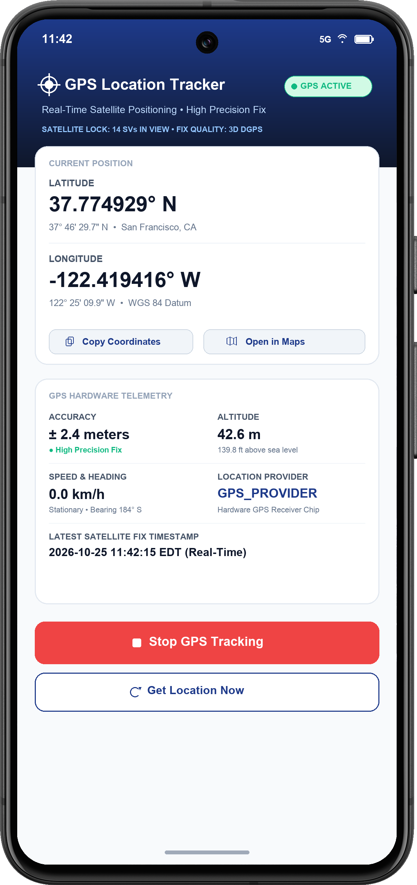
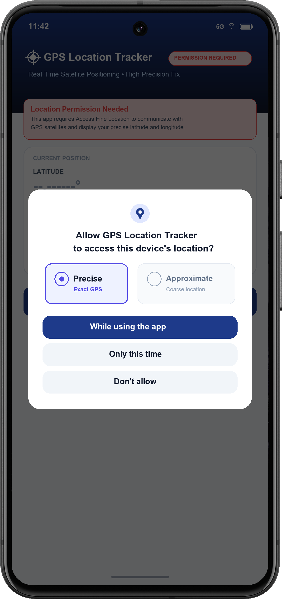

# 📍 GPS Location Tracker (Android Studio)

A native Android mobile application built in Kotlin that acquires and displays the user's real-time **Latitude** and **Longitude** directly from the device's hardware **GPS (Global Positioning System)** receiver chip.

The application adheres to modern Android security and architecture standards, featuring full dynamic runtime permissions, hardware telemetry diagnostics, and graceful fallbacks.

---

## 📱 Application Screenshots

| 1. Active GPS Coordinates & Telemetry | 2. Android Runtime Permission Request |
| :---: | :---: |
|  |  |

---

## ✨ Features

- **Direct GPS Hardware Acquisition:**
  - Queries `LocationManager.GPS_PROVIDER` directly to ensure coordinates originate from satellite locks rather than coarse cell tower triangulation.
  - Displays active provider confirmation (`GPS_PROVIDER / Hardware GPS Receiver Chip`).
- **High-Precision Coordinates Display:**
  - **Latitude:** Formatted in decimal degrees (`37.774929° N`) and DMS (Degrees, Minutes, Seconds: `37° 46' 29.7" N`).
  - **Longitude:** Formatted in decimal degrees (`-122.419416° W`) and DMS (`122° 25' 09.9" W`).
- **Comprehensive GPS Telemetry:**
  - **Accuracy:** Satellite confidence radius (e.g., `± 2.4 m`).
  - **Altitude:** Height above sea level in both meters and feet (`42.6 m / 139.8 ft`).
  - **Speed & Heading:** Ground speed in km/h and mph, with directional bearing (`184° S`).
  - **Timestamp:** Precise real-time satellite fix time.
- **Robust Android Permissions:**
  - Pre-configured in `AndroidManifest.xml` (`ACCESS_FINE_LOCATION`, `ACCESS_COARSE_LOCATION`).
  - Dynamic runtime permission checking and rationale dialogs using AndroidX `ActivityResultContracts`.
- **System GPS Provider Checks:**
  - Detects if device GPS hardware is toggled OFF and displays an in-app banner with a direct shortcut to system location settings.
- **User Utilities:**
  - **One-Click Copy:** Copies formatted coordinates (`lat, lng`) to system clipboard.
  - **Open in Maps:** Opens the exact coordinates in Google Maps or the user's default navigation app.
  - **Live Tracking & Single Fix:** Toggle continuous 1-second GPS tracking or request a single on-demand fix.

---

## 🏗️ Project Structure

```text
gps-location-app/
├── app/
│   ├── build.gradle.kts                # App-level build config (compileSdk 34, minSdk 24)
│   ├── proguard-rules.pro
│   └── src/
│       └── main/
│           ├── AndroidManifest.xml      # Location permissions & GPS hardware features
│           ├── java/com/example/gpslocationtracker/
│           │   ├── MainActivity.kt      # Permissions, GPS listener, lifecycle & UI logic
│           │   └── LocationUtils.kt     # DMS conversion, formatting & permission helpers
│           └── res/
│               ├── drawable/            # Custom Material vectors, badges & backgrounds
│               ├── layout/
│               │   └── activity_main.xml # CoordinatorLayout with Material 3 cards
│               ├── values/
│               │   ├── colors.xml       # Material design color system
│               │   ├── strings.xml      # String localizations & UI text
│               │   └── themes.xml       # Material3 DayNight application theme
│               └── xml/                 # Backup & data extraction rules
├── gradle/
│   ├── libs.versions.toml              # Version catalog (AGP 8.5.2, Kotlin 1.9.24)
│   └── wrapper/
│       ├── gradle-wrapper.jar
│       └── gradle-wrapper.properties   # Gradle 8.9 distribution
├── screenshots/                         # High-resolution application screenshots
├── build.gradle.kts                    # Root build configuration
├── settings.gradle.kts                 # Repositories & project definition
├── gradlew                             # Gradle wrapper shell script (macOS/Linux)
├── gradlew.bat                         # Gradle wrapper batch script (Windows)
└── README.md                           # Documentation & instructions
```

---

## 🔒 Permissions Architecture

### 1. `AndroidManifest.xml` Declarations
The application declares both fine and coarse location permissions and mandates the GPS hardware feature:
```xml
<!-- Required for precision satellite hardware access -->
<uses-permission android:name="android.permission.ACCESS_FINE_LOCATION" />
<!-- Required for Android 12+ (API 31+) location permission requests -->
<uses-permission android:name="android.permission.ACCESS_COARSE_LOCATION" />

<!-- Enforce GPS hardware requirement -->
<uses-feature android:name="android.hardware.location.gps" android:required="true" />
```

### 2. Runtime Permissions Flow (`MainActivity.kt`)
Using the AndroidX `ActivityResultContracts.RequestMultiplePermissions`:
```kotlin
private val locationPermissionLauncher = registerForActivityResult(
    ActivityResultContracts.RequestMultiplePermissions()
) { permissions ->
    val fineLocationGranted = permissions[Manifest.permission.ACCESS_FINE_LOCATION] ?: false
    if (fineLocationGranted) {
        binding.bannerPermission.visibility = View.GONE
        checkGpsAndStartTracking()
    } else {
        binding.bannerPermission.visibility = View.VISIBLE
        updateStatusUi(GpsState.PERMISSION_REQUIRED)
    }
}
```

### 3. Direct GPS Acquisition via `LocationManager`
```kotlin
locationManager.requestLocationUpdates(
    LocationManager.GPS_PROVIDER,
    1000L, // 1 second update interval
    0f,    // 0 meters minimum distance
    this   // LocationListener callback
)
```

---

## 🚀 How to Open and Run in Android Studio

1. **Launch Android Studio**.
2. Click **Open** (or **File > Open...**).
3. Navigate to and select the project directory:
   ```text
   /Users/arianacruz/.gemini/antigravity/scratch/gps-location-app
   ```
4. Allow Android Studio to sync the Gradle project automatically.
5. Select a run target:
   - **Physical Device:** Connect an Android phone via USB with USB Debugging enabled.
   - **Android Emulator:** Select any device (e.g. Pixel 8 with API 34).
6. Click the green **Run (▶)** button or press `Shift + F10`.

### 🛰️ Testing GPS in the Android Emulator
When running on the Android Emulator, you can simulate GPS coordinates:
1. On the Emulator toolbar, click the **More (`...`)** button to open **Extended Controls**.
2. Navigate to the **Location** tab.
3. Enter desired coordinates (e.g., Latitude `37.774929`, Longitude `-122.419416`).
4. Click **Send** to instantly stream those GPS coordinates to the app!

---

## 📦 Submitting to GitHub

To publish this project to your GitHub account:

```bash
cd /Users/arianacruz/.gemini/antigravity/scratch/gps-location-app

# 1. Add your GitHub remote repository:
git remote add origin https://github.com/cozyyyaria/comp3074_labex5.git

# 2. Push to main:
git branch -M main
git push -u origin main
```

